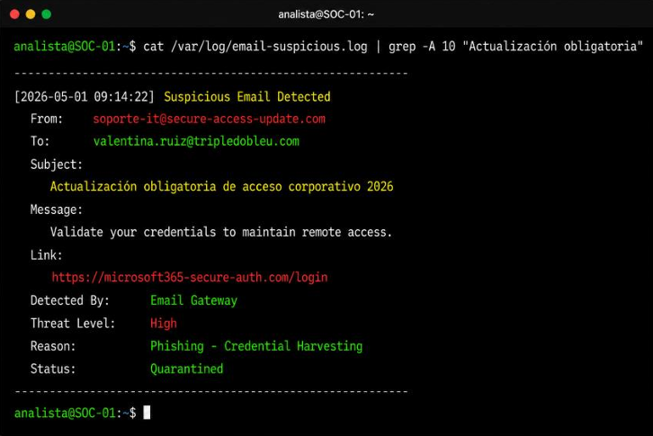
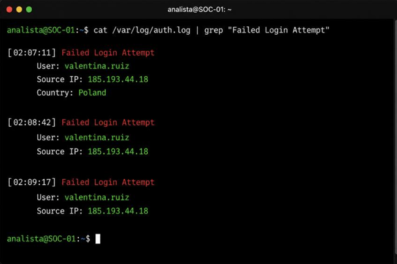
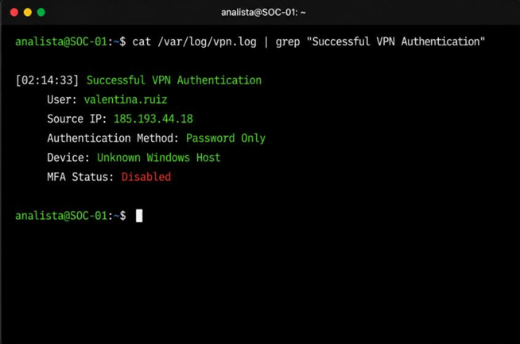
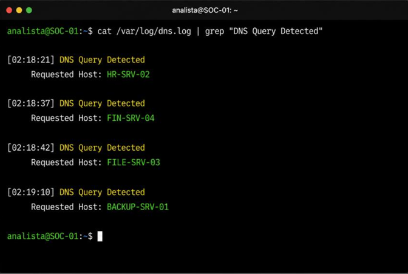
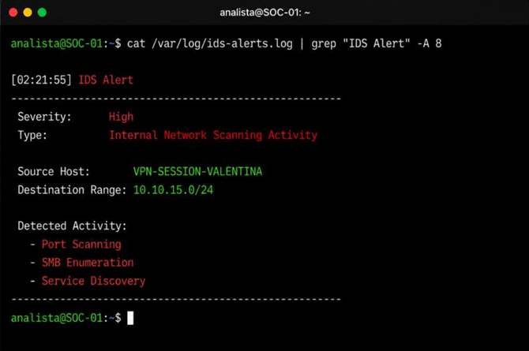
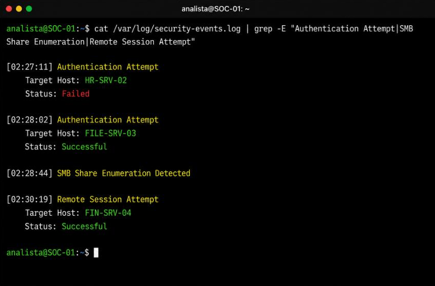
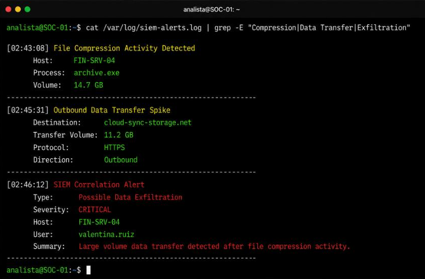

# 🛡️ Análise de Incidente — Tripledobleu Inc.

**Mini projeto técnico · Mulher Digital (Junior Achievement Américas)**
**Papel:** Analista júnior do SOC
**Autora:** Inara Lopes

> Análise básica de um incidente de segurança que começou com **phishing**, passou por **comprometimento de credenciais**, **acesso via VPN sem MFA**, **reconhecimento interno**, **movimentação lateral** e terminou em **possível exfiltração de dados** de um servidor financeiro.

---

## 📑 Índice

1. [Resumo executivo](#1-resumo-executivo)
2. [Como a análise foi feita (metodologia)](#2-como-a-análise-foi-feita-metodologia)
3. [Contexto da empresa](#3-contexto-da-empresa)
4. [Linha do tempo do incidente](#4-linha-do-tempo-do-incidente)
5. [Análise das evidências (logs)](#5-análise-das-evidências-logs)
6. [Ameaças, vulnerabilidades e engenharia social](#6-ameaças-vulnerabilidades-e-engenharia-social)
7. [Sinais que poderiam ter alertado o SOC](#7-sinais-que-poderiam-ter-alertado-o-soc)
8. [Controles presentes e controles que faltaram](#8-controles-presentes-e-controles-que-faltaram)
9. [Relação com os conceitos do módulo](#9-relação-com-os-conceitos-do-módulo)
10. [Resposta inicial e ações de contenção](#10-resposta-inicial-e-ações-de-contenção)
11. [Impacto operacional e por que o risco é importante](#11-impacto-operacional-e-por-que-o-risco-é-importante)
12. [Recomendações para evitar um novo incidente](#12-recomendações-para-evitar-um-novo-incidente)
13. [Conclusão](#13-conclusão)
14. [Checklist: requisitos do enunciado e onde estão atendidos](#14-checklist-requisitos-do-enunciado-e-onde-estão-atendidos)
15. [Estrutura do repositório](#15-estrutura-do-repositório)

---

## 1. Resumo executivo

Na madrugada de uma terça-feira, o SIEM da Tripledobleu Inc. registrou tentativas de login malsucedidas na conta da analista financeira **Valentina Ruiz**, vindas de um IP da **Polônia** (`185.193.44.18`). Poucos minutos depois, o mesmo IP conseguiu entrar na **VPN corporativa usando apenas senha** (a conta não tinha MFA). A partir dali, o atacante fez reconhecimento da rede, autenticou-se em servidores internos aproveitando **permissões excessivas**, compactou **14,7 GB** de arquivos no servidor financeiro `FIN-SRV-04` e enviou **11,2 GB** para um armazenamento externo na nuvem.

A causa raiz provável foi um **e-mail de phishing** recebido dias antes, no qual Valentina digitou suas credenciais em uma página falsa que imitava o Microsoft 365. Ela não reportou o e-mail ao time de segurança.

**Em uma frase:** credencial roubada + ausência de MFA + permissões excessivas + falta de segmentação = acesso até os dados mais sensíveis da empresa.

---

## 2. Como a análise foi feita (metodologia)

O enunciado pede que o caso seja revisado com cuidado em oito frentes: **narrativa, logs, alertas do SIEM, eventos de autenticação, consultas DNS, alertas do IDS, tentativas de acesso interno e e-mail de phishing**. Para não analisar cada item de forma isolada, segui este roteiro:

| Passo | O que fiz | Por quê |
|---|---|---|
| **1. Ler a narrativa** | Identifiquei a empresa, a usuária afetada, o modelo híbrido com VPN e as fraquezas já conhecidas (senhas fracas, MFA não obrigatório, servidores legados, alertas acumulados) | Entender o que era "normal" antes de procurar o que era anormal |
| **2. Organizar por horário** | Coloquei todos os logs em ordem cronológica (seção 4) | Um incidente só faz sentido como sequência |
| **3. Interrogar cada log** | Respondi sempre as mesmas perguntas (abaixo) | Manter um critério único de análise |
| **4. Correlacionar** | Liguei os logs por campos em comum (tabela abaixo) | É a correlação que transforma eventos soltos em um ataque |
| **5. Classificar** | Separei o que é ameaça, vulnerabilidade, sinal de engenharia social e controle de segurança | Cumprir os pontos que o enunciado pede para identificar |
| **6. Relacionar aos conceitos** | Conectei cada achado aos temas do módulo (MFA, DNS, IDS/IPS, OSI, segmentação etc.) | É o principal critério de avaliação |
| **7. Propor contenção** | Listei ações imediatas, de curto e de médio prazo | Fechar o ciclo com a resposta inicial a incidentes |

### Perguntas que apliquei a cada log

1. **Quem?** Qual usuário, conta ou host aparece?
2. **De onde?** Qual IP de origem, e de qual país?
3. **Quando?** O horário combina com o comportamento normal da conta?
4. **O quê?** Qual ação, serviço ou protocolo foi usado?
5. **Resultado?** Sucesso ou falha?
6. **É normal para esse perfil?** Uma analista financeira faria isso?
7. **Que controle deveria ter reagido?** MFA, IDS/IPS, SIEM, DLP, controle de acesso?

### Campos usados para correlacionar os eventos

| Campo em comum | Onde aparece | O que permite concluir |
|---|---|---|
| Usuário `valentina.ruiz` | e-mail, `auth.log`, `vpn.log`, SIEM | Todos os eventos giram em torno da mesma conta |
| IP `185.193.44.18` | `auth.log` e `vpn.log` | As falhas e o sucesso vieram do mesmo atacante |
| `VPN-SESSION-VALENTINA` | `ids-alerts.log` | O reconhecimento interno saiu da sessão VPN comprometida |
| Servidores `HR-SRV-02`, `FIN-SRV-04`, `FILE-SRV-03`, `BACKUP-SRV-01` | DNS, eventos de segurança, SIEM | O atacante consultou, tentou acessar e depois atacou os mesmos alvos |
| Horários (02:07 a 02:46) | Todos os logs | Tudo ocorreu em cerca de 39 minutos |

> Nenhuma ferramenta avançada foi usada. A análise foi feita lendo os logs fornecidos e aplicando os conceitos vistos no módulo, como o enunciado orienta.

---

## 3. Contexto da empresa

| Item | Descrição |
|---|---|
| Empresa | Tripledobleu Inc. |
| Setor | Serviços financeiros e plataformas digitais empresariais |
| Operação | México, Colômbia e Estados Unidos |
| Modelo de trabalho | Híbrido, com centenas de funcionários usando VPN diariamente |
| Situação de segurança | Senhas fracas, MFA não obrigatório, servidores legados com configurações antigas e alertas de baixo/médio nível acumulados sem revisão |

A digitalização acelerada (nuvem e acesso remoto) ampliou a **superfície de ataque** sem que os controles de segurança acompanhassem esse crescimento.

---

## 4. Linha do tempo do incidente

| Horário | Evento | Fonte do log | Fase do ataque |
|---|---|---|---|
| ~2 dias antes | E-mail de phishing (domínio parecido com o do Microsoft 365). Valentina insere usuário e senha e não reporta o e-mail. | Email Gateway | Acesso inicial / engenharia social |
| 02:07:11 | 1ª tentativa de login falha, IP `185.193.44.18` (Polônia) | `auth.log` | Tentativa de acesso |
| 02:08:42 | 2ª tentativa falha, mesmo IP | `auth.log` | Tentativa de acesso |
| 02:09:17 | 3ª tentativa falha, mesmo IP | `auth.log` | Tentativa de acesso |
| **02:14:33** | **Login VPN bem-sucedido**, mesmo IP, só senha, **MFA desativado**, dispositivo desconhecido | `vpn.log` | **Comprometimento da conta** |
| 02:18:21 a 02:19:10 | Consultas DNS a `HR-SRV-02`, `FIN-SRV-04`, `FILE-SRV-03`, `BACKUP-SRV-01` | `dns.log` | Reconhecimento |
| 02:21:55 | Alerta IDS (Alta): port scanning, enumeração SMB e service discovery em `10.10.15.0/24` | `ids-alerts.log` | Reconhecimento interno |
| 02:27:11 | Tentativa de autenticação em `HR-SRV-02` (**falhou**) | `security-events.log` | Movimentação lateral |
| 02:28:02 | Autenticação em `FILE-SRV-03` (**sucesso**) | `security-events.log` | Movimentação lateral |
| 02:28:44 | Enumeração de compartilhamentos SMB detectada | `security-events.log` | Descoberta de dados |
| 02:30:19 | Sessão remota em `FIN-SRV-04` (**sucesso**) | `security-events.log` | Movimentação lateral |
| 02:43:08 | Compactação de **14,7 GB** por `archive.exe` em `FIN-SRV-04` | `siem-alerts.log` | Coleta / preparação dos dados |
| 02:45:31 | Pico de tráfego de saída: **11,2 GB** por HTTPS para `cloud-sync-storage.net` | `siem-alerts.log` | Exfiltração |
| **02:46:12** | **Alerta CRÍTICO do SIEM:** possível exfiltração de dados | `siem-alerts.log` | Detecção tardia |
| Depois | Sistemas isolados/desconectados, pagamentos falhando, SOC investigando o alcance | Narrativa do caso | Impacto operacional |

⏱️ **Tempo total:** cerca de **39 minutos** entre a primeira tentativa de login (02:07) e o alerta crítico de exfiltração (02:46). Cerca de **31 minutos** entre a entrada na VPN (02:14) e o alerta crítico.

> **Observação:** o log do e-mail registra a data `2026-05-01`. A narrativa diz "dois dias antes do ataque". Neste relatório considero a informação da narrativa como referência aproximada.

---

## 5. Análise das evidências (logs)

### 5.1 Phishing — E-mail suspeito



> 🔎 **Como foi identificado:** Comecei pela narrativa (a investigação revelou um e-mail dois dias antes do ataque) e abri o log do gateway de e-mail. Comparei remetente e link com o domínio oficial `tripledobleu.com` e com o portal do Microsoft 365: nenhum dos dois pertencia à empresa. O campo *Reason* (Credential Harvesting) confirmou o objetivo do e-mail.

**O que o log mostra**

| Campo | Valor | Interpretação |
|---|---|---|
| From | `soporte-it@secure-access-update.com` | Domínio **externo** fingindo ser o suporte de TI |
| To | `valentina.ruiz@tripledobleu.com` | Alvo específico: analista financeira |
| Subject | "Actualización obligatoria de acceso corporativo 2026" | Urgência e falsa obrigatoriedade |
| Link | `https://microsoft365-secure-auth.com/login` | **Domínio parecido** com o do Microsoft 365 (typosquatting) |
| Detected By | Email Gateway | Existia um controle de e-mail |
| Reason | Phishing - Credential Harvesting | Objetivo: coletar credenciais |
| Status | Quarantined | O gateway colocou o e-mail em quarentena |

**Observações**

- Sinais clássicos de **engenharia social**: falsa autoridade (TI), urgência ("obrigatória"), pedido de credenciais e link para domínio que não pertence ao Microsoft 365.
- O gateway **detectou** a ameaça, mas segundo a narrativa Valentina chegou a inserir as credenciais. Isso indica que o e-mail pode ter chegado à caixa de entrada antes da quarentena, ou que outra mensagem similar passou. Em qualquer caso, **só a tecnologia não bastou**: faltou treinamento e o hábito de reportar.
- Este é o **ponto de partida (acesso inicial)** do incidente.

---

### 5.2 Tentativas de login malsucedidas



> 🔎 **Como foi identificado:** Filtrei o `auth.log` por *Failed Login Attempt* (o comando aparece na evidência). Três falhas seguidas, mesmo usuário e mesmo IP, chamaram a atenção. O campo *Country* mostrou Polônia e o horário (madrugada) foge do padrão de trabalho descrito na narrativa.

**O que o log mostra**

- 3 tentativas falhas consecutivas para `valentina.ruiz` (02:07:11, 02:08:42, 02:09:17).
- Mesmo IP de origem: `185.193.44.18`, com país identificado como **Polônia**.

**Observações**

A atividade é suspeita porque:

- ocorreu **fora do horário de trabalho habitual** (madrugada);
- o IP vem de **outro país**, diferente do padrão da usuária;
- há **múltiplas tentativas consecutivas** de autenticação malsucedida.

Pode estar relacionada a **roubo de credenciais**, **força bruta**, **credential stuffing** ou **tentativa de acesso não autorizado**. As tentativas são espaçadas (cerca de 1 a 1,5 minuto), o que sugere testes manuais ou controlados, possivelmente com credenciais já obtidas. É um **indicador inicial de comprometimento de conta**.

---

### 5.3 Acesso VPN bem-sucedido



> 🔎 **Como foi identificado:** Procurei no `vpn.log` o que aconteceu depois das falhas e comparei o *Source IP*: era o mesmo. Depois li *Authentication Method*, *Device* e *MFA Status*, que explicam por que o login foi aceito.

**O que o log mostra**

| Campo | Valor |
|---|---|
| Horário | 02:14:33 |
| Usuário | `valentina.ruiz` |
| IP de origem | `185.193.44.18` (o mesmo das falhas) |
| Método | **Password Only** |
| Dispositivo | **Unknown Windows Host** |
| MFA | **Disabled** |

**Observações**

- Esse é o **momento do comprometimento efetivo**. O atacante passou de "tentando entrar" para "dentro da rede".
- O mesmo IP que falhou antes agora teve sucesso. Isso é uma **correlação importante**: falhas seguidas de sucesso a partir da mesma origem costumam indicar que o atacante conseguiu a credencial correta.
- Com **MFA ativo**, ter só a senha não seria suficiente. Esta é a **principal falha de controle** do caso.
- O **dispositivo desconhecido** e o acesso de outro país deveriam ter gerado bloqueio ou verificação adicional.

---

### 5.4 Consultas DNS internas



> 🔎 **Como foi identificado:** Com o login na VPN confirmado, fui ao `dns.log` ver o que a sessão fez. Comparei os servidores consultados com o perfil normal da Valentina (apenas plataformas financeiras em horário administrativo), descrito na narrativa.

**O que o log mostra**

Consultas DNS em menos de 1 minuto para: `HR-SRV-02` (02:18:21), `FIN-SRV-04` (02:18:37), `FILE-SRV-03` (02:18:42) e `BACKUP-SRV-01` (02:19:10).

**Observações**

- Valentina normalmente acessava apenas plataformas financeiras específicas em horário administrativo. Consultar servidores de **RH, arquivos e backup** foge totalmente do perfil dela.
- O DNS traduz nomes em endereços IP. Ao consultar esses nomes, o atacante estava **mapeando a rede** para descobrir onde estavam os recursos de valor.
- O interesse em `BACKUP-SRV-01` é relevante: backups podem ser alvo para **apagar ou criptografar cópias** (preparação para ransomware) ou para roubar dados.
- O log de DNS é útil para **reconstruir o comportamento** e identificar quais sistemas foram "visitados".

---

### 5.5 Varreduras — Alerta do IDS



> 🔎 **Como foi identificado:** No `ids-alerts.log`, o campo *Source Host* (`VPN-SESSION-VALENTINA`) ligou o alerta à sessão já suspeita. A severidade, o tipo e a lista *Detected Activity* mostraram a técnica usada.

**O que o log mostra**

| Campo | Valor |
|---|---|
| Horário | 02:21:55 |
| Severidade | **High** |
| Tipo | Internal Network Scanning Activity |
| Origem | `VPN-SESSION-VALENTINA` |
| Destino | `10.10.15.0/24` |
| Atividade | Port Scanning, SMB Enumeration, Service Discovery |

**Observações**

- Uma analista financeira não faz varredura de portas nem enumeração SMB. Isso confirma que **quem estava usando a sessão não era a Valentina**.
- A origem é a **sessão VPN** dela, o que liga o reconhecimento diretamente ao acesso indevido.
- Port scanning (camadas 3 e 4 do modelo OSI) busca portas abertas; a enumeração SMB (camada 7) busca **pastas e recursos compartilhados**.
- O **IDS detectou, mas não bloqueou**. Um **IPS** configurado para agir poderia ter interrompido a sessão. Isso reforça a diferença: IDS **alerta**, IPS **alerta e bloqueia**.
- O alcance de um `/24` mostra que a rede permitia que uma sessão VPN de uma usuária comum chegasse a **vários hosts**, o que indica **segmentação insuficiente**.

---

### 5.6 Permissões excessivas — Eventos de autenticação interna



> 🔎 **Como foi identificado:** No `security-events.log` filtrei autenticação, enumeração SMB e sessão remota. Os resultados *Successful* em `FILE-SRV-03` e `FIN-SRV-04` mostram até onde a conta chegou, e a narrativa explica o motivo (permissões excessivas e grupos administrativos mal segmentados).

**O que o log mostra**

| Horário | Evento | Alvo | Resultado |
|---|---|---|---|
| 02:27:11 | Authentication Attempt | `HR-SRV-02` | ❌ Failed |
| 02:28:02 | Authentication Attempt | `FILE-SRV-03` | ✅ Successful |
| 02:28:44 | SMB Share Enumeration Detected | (compartilhamentos) | Detectado |
| 02:30:19 | Remote Session Attempt | `FIN-SRV-04` | ✅ Successful |

**Observações**

- O atacante testou vários servidores. Parte falhou, mas **o acesso ao servidor de arquivos e ao servidor financeiro funcionou**.
- Uma conta de analista financeira conseguir sessão remota em um servidor financeiro crítico e em armazenamento compartilhado indica **permissões acima do necessário**, quebrando o **princípio do menor privilégio**.
- A investigação confirmou depois que sistemas legados tinham **grupos administrativos mal segmentados** e contas com mais acesso do que a função exigia.
- Isto é **movimentação lateral**: o atacante saiu do ponto de entrada (VPN) e avançou para onde estavam os dados.

---

### 5.7 Compactação e exfiltração de dados



> 🔎 **Como foi identificado:** No `siem-alerts.log`, as palavras do filtro (*Compression*, *Data Transfer*, *Exfiltration*) levam à sequência compactar e depois enviar. Comparei horários, volumes e destino, e o alerta de correlação CRITICAL confirmou que o SIEM ligou tudo ao usuário `valentina.ruiz`.

**O que o log mostra**

| Horário | Alerta | Detalhes |
|---|---|---|
| 02:43:08 | File Compression Activity | `FIN-SRV-04`, processo `archive.exe`, **14,7 GB** |
| 02:45:31 | Outbound Data Transfer Spike | Destino `cloud-sync-storage.net`, **11,2 GB**, HTTPS, saída |
| 02:46:12 | **SIEM Correlation Alert (CRITICAL)** | Possible Data Exfiltration, usuário `valentina.ruiz` |

**Observações**

- Padrão típico de exfiltração: **primeiro compacta** (facilita e acelera a transferência), **depois envia** para fora.
- O destino é um **serviço de nuvem desconhecido** com nome que imita um serviço de sincronização legítimo.
- O envio usa **HTTPS (porta 443)**, tráfego criptografado que se mistura ao tráfego web normal. Sem inspeção ou regras de saída, é difícil distinguir de uso legítimo.
- O volume é **muito acima do comportamento normal** do servidor.
- A **correlação do SIEM** foi o que ligou compactação e transferência ao usuário comprometido. Isso mostra o valor do SIEM, mas o alerta chegou **tarde**: os dados já estavam saindo.
- Pelo cronograma, 11,2 GB já tinham sido enviados quando o alerta foi gerado. É preciso **confirmar** o volume total e quais arquivos foram enviados.

---

## 6. Ameaças, vulnerabilidades e engenharia social

### 6.1 Ameaças identificadas

| Ameaça | Onde aparece |
|---|---|
| **Phishing / coleta de credenciais** | E-mail falso de "TI" com link para domínio imitando o Microsoft 365 |
| **Comprometimento de conta** | Login VPN válido de um IP estrangeiro |
| **Acesso não autorizado** | Sessão VPN usada por terceiro |
| **Reconhecimento interno** | Consultas DNS, port scanning, enumeração SMB |
| **Movimentação lateral** | Autenticações em `FILE-SRV-03` e `FIN-SRV-04` |
| **Exfiltração de dados** | Compactação e envio de 11,2 GB para a nuvem externa |

### 6.2 Vulnerabilidades que facilitaram o incidente

| Vulnerabilidade | Como contribuiu |
|---|---|
| **MFA não obrigatório** | Permitiu acesso à VPN apenas com a senha roubada |
| **Senhas fracas** | Facilitam roubo, adivinhação e reutilização |
| **Permissões excessivas** | A conta de uma analista alcançou servidores críticos |
| **Servidores legados com configurações antigas** | Maior chance de falhas e menos controles |
| **Grupos administrativos mal segmentados** | Ampliaram o alcance do atacante |
| **Segmentação de rede fraca** | Uma sessão VPN conseguiu varrer um `/24` e chegar a vários servidores |
| **Alertas acumulados sem revisão** | Sobrecarga do SOC e risco de ignorar sinais reais |
| **Falta de bloqueio/verificação por geolocalização e dispositivo** | Aceitou login de outro país e de host desconhecido |
| **Filtro de saída (egress) e DLP limitados** | Grandes volumes saíram por HTTPS para a nuvem externa |
| **Reação inicial de triagem** | O alerta de login falho foi tratado como possível falso positivo |

### 6.3 Fator humano e engenharia social

- **Falsa autoridade:** o e-mail parecia vir da TI.
- **Urgência:** "atualização obrigatória".
- **Aparência legítima:** domínio parecido com o Microsoft 365.
- **Confiança na rotina:** Valentina presumiu que era procedimento normal.
- **Falta de reporte:** o e-mail não foi comunicado à equipe de segurança, o que impediu uma resposta antecipada (por exemplo, trocar a senha e investigar outros destinatários).

> 💡 A segurança depende de tecnologia, processos **e pessoas**. Treinamento contínuo e canais simples para reportar suspeitas são controles tão importantes quanto o firewall.

---

## 7. Sinais que poderiam ter alertado o SOC

| # | Sinal | Quando | Por que era um alerta |
|---|---|---|---|
| 1 | E-mail de phishing detectado e em quarentena | ~2 dias antes | Já indicava campanha contra funcionários. Era hora de verificar quem recebeu/clicou e orientar usuários |
| 2 | Múltiplas falhas de login seguidas | 02:07 a 02:09 | Padrão anormal, fora do horário e de outro país |
| 3 | Login de **outro país** logo após as falhas | 02:14 | Falhas seguidas de sucesso do mesmo IP |
| 4 | **Dispositivo desconhecido** + **sem MFA** | 02:14 | Dois fatores de risco juntos |
| 5 | Consultas DNS fora do perfil | 02:18 | Comportamento diferente do normal da conta |
| 6 | **Alerta IDS de alta severidade** | 02:21 | Reconhecimento interno claro |
| 7 | Autenticações em servidores sem relação com a função | 02:27 a 02:30 | Movimentação lateral |
| 8 | Compactação massiva em servidor financeiro | 02:43 | Preparação para exfiltração |
| 9 | Pico de tráfego de saída para nuvem desconhecida | 02:45 | Exfiltração em andamento |

**Principal lição:** houve **pelo menos 7 sinais antes do alerta crítico**. Se os primeiros tivessem sido tratados como incidente (e não como possível falso positivo), a resposta teria começado cerca de **30 minutos antes** e poderia ter evitado a perda de dados.

---

## 8. Controles presentes e controles que faltaram

### ✅ Controles que existiam

| Controle | Função no caso |
|---|---|
| **SIEM** | Centralizou logs e fez a correlação que gerou o alerta crítico |
| **IDS** | Detectou o reconhecimento interno |
| **Email Gateway** | Detectou o phishing e colocou em quarentena |
| **VPN corporativa** | Acesso remoto controlado (porém sem MFA) |
| **Logs de autenticação, DNS e eventos** | Permitiram reconstruir a sequência do ataque |
| **Monitoramento 24/7 (SOC)** | Havia analista de plantão observando |

### ❌ Controles que poderiam ter faltado ou estavam fracos

| Controle ausente/insuficiente | O que poderia ter feito |
|---|---|
| **MFA obrigatório** | Teria barrado o login VPN com senha roubada |
| **Política de senhas fortes** | Reduziria risco de roubo e adivinhação |
| **Bloqueio por tentativas falhas / alerta por limiar** | Resposta imediata às 3 falhas |
| **Restrição geográfica / "viagem impossível"** | Bloquearia ou exigiria validação extra para IP da Polônia |
| **Verificação de dispositivo (device posture)** | Rejeitaria host desconhecido |
| **Controle de acesso por menor privilégio (RBAC)** | Impediria acesso de analista a servidores críticos |
| **Segmentação de rede** | Limitaria o alcance da sessão VPN |
| **IPS ativo (bloqueio automático)** | Cortaria a sessão durante a varredura |
| **DLP e filtro de saída** | Bloquearia ou alertaria o envio para nuvem não autorizada |
| **Hardening/atualização de servidores legados** | Menos pontos fracos |
| **Triagem e priorização de alertas** | Evitaria acúmulo de alertas sem revisão |
| **Treinamento anti-phishing e canal de reporte** | Teria evitado ou comunicado o e-mail |
| **Plano de resposta a incidentes testado** | Contenção mais rápida |

---

## 9. Relação com os conceitos do módulo

| Conceito | Como aparece no caso |
|---|---|
| **Fundamentos de redes** | Rede híbrida com VPN conectando usuários remotos aos servidores internos; faixa `10.10.15.0/24` varrida |
| **Protocolos** | **DNS** (resolução de nomes), **SMB** (compartilhamento de arquivos), **HTTPS** (exfiltração), **TCP/IP** (varredura de portas) |
| **Endereços IP** | IP externo `185.193.44.18` (Polônia) como origem; rede interna privada `10.10.15.0/24` |
| **DNS** | Consultas a servidores internos revelaram o reconhecimento |
| **Autenticação** | Tentativas falhas, depois sucesso apenas com senha |
| **MFA** | Estava desativado; seria a barreira mais eficaz |
| **Controle de acesso** | Permissões excessivas e grupos administrativos mal segmentados |
| **Modelo OSI** | Ver tabela abaixo |
| **IDS/IPS** | O IDS detectou o scanning; um IPS poderia ter bloqueado |
| **Monitoramento** | SIEM e SOC detectaram, mas com atraso na reação |
| **Logs** | Cada log contou parte da história (ver seção 5) |
| **Alertas** | Falsos positivos vs. alertas reais; fadiga de alertas |
| **Segmentação** | A falta dela permitiu o movimento lateral |
| **Resposta inicial a incidentes** | Ver seção 10 |

### Modelo OSI aplicado ao caso

| Camada | Exemplo no incidente |
|---|---|
| **7 - Aplicação** | E-mail de phishing, página de login falsa, DNS, SMB, HTTPS |
| **6 - Apresentação** | Criptografia TLS no tráfego HTTPS de saída |
| **5 - Sessão** | Sessão VPN do atacante; sessões remotas nos servidores |
| **4 - Transporte** | Port scanning (TCP/UDP) e conexões nas portas dos serviços |
| **3 - Rede** | Endereçamento IP (origem `185.193.44.18`, rede `10.10.15.0/24`), roteamento via VPN |
| **2 - Enlace** | Segmentação por VLANs poderia limitar o alcance local |
| **1 - Física** | Sem evidência direta neste caso |

---

## 10. Resposta inicial e ações de contenção

### 🔴 Imediatas (primeiros minutos)

1. **Confirmar o incidente** e escalar ao responsável de segurança/gestão (severidade crítica).
2. **Encerrar a sessão VPN** de Valentina e **desativar/bloquear a conta**.
3. **Bloquear o IP** `185.193.44.18` no firewall e na VPN.
4. **Bloquear o destino** `cloud-sync-storage.net` (DNS, proxy e firewall) para **interromper a exfiltração**.
5. **Isolar `FIN-SRV-04`** e **`FILE-SRV-03`** da rede, preservando o estado para investigação.
6. **Preservar evidências**: logs, imagens/snapshots, capturas e horários.

### 🟠 Curto prazo (primeiras horas)

7. **Redefinir a senha** de Valentina e revogar tokens/sessões ativas.
8. **Bloquear os domínios de phishing**: `secure-access-update.com` e `microsoft365-secure-auth.com`.
9. **Identificar outros destinatários** do e-mail e verificar quem clicou ou digitou credenciais; redefinir senhas dessas contas.
10. **Buscar o IP e o dispositivo desconhecido** em logs de outras contas.
11. **Verificar `HR-SRV-02` e `BACKUP-SRV-01`** em busca de acesso ou alterações.
12. **Revisar contas privilegiadas** e verificar persistência (novas contas, tarefas agendadas, etc.).
13. **Determinar quais dados foram enviados** e o volume final real.

### 🟡 Médio prazo

14. **Exigir MFA** para todas as contas, começando por VPN e contas financeiras.
15. **Revisar permissões** (menor privilégio) e segmentar a rede.
16. **Ajustar o IDS/IPS** e criar regras de alerta para falhas, geolocalização e tráfego de saída.
17. **Comunicar** áreas internas, jurídico e, se aplicável, clientes e autoridades conforme exigências legais.
18. **Documentar lições aprendidas** e atualizar o plano de resposta.

---

## 11. Impacto operacional e por que o risco é importante

### Impactos observados ou prováveis

| Área | Impacto |
|---|---|
| **Operações** | Sistemas financeiros desconectados; equipes sem acesso a relatórios internos; servidores críticos isolados |
| **Processos financeiros** | Falhas em pagamentos e análises automatizadas |
| **Confidencialidade** | Possível exposição de dados de clientes corporativos, operações financeiras e documentação interna |
| **Disponibilidade** | Interrupção por contenção e risco sobre os backups |
| **Integridade** | Incerteza sobre o que mais foi acessado ou alterado |
| **Financeiro** | Custos de investigação, recuperação, paralisação e possíveis multas |
| **Legal/regulatório** | Setor financeiro e operação em 3 países implicam exigências de proteção de dados e notificação |
| **Reputação** | Perda de confiança de clientes corporativos |

### Por que o incidente é um risco importante

- Envolve **dados financeiros e de clientes corporativos**, ativos de alto valor.
- Houve **exfiltração real**, e a empresa **perde o controle sobre os dados** depois que saem.
- O atacante chegou ao **servidor financeiro crítico** com uma única conta de usuária comum, evidenciando que a **superfície de ataque é grande**.
- As fraquezas (MFA, permissões, segmentação) são **sistêmicas**: se afetam uma conta, podem afetar outras.
- Dados roubados podem ser usados para **extorsão, fraude, venda ou novos ataques** contra os clientes.
- Impacta os três pilares da segurança (**confidencialidade, integridade e disponibilidade**).

---

## 12. Recomendações para evitar um novo incidente

1. **MFA obrigatório** para todos os usuários (prioridade máxima).
2. **Política de senhas fortes** e uso de gerenciador de senhas.
3. **Menor privilégio** e revisão periódica de acessos e grupos administrativos.
4. **Segmentação de rede** (VPN separada por perfil, VLANs, firewall interno).
5. **IPS em modo de bloqueio** para ameaças de alta severidade.
6. **DLP e filtros de saída** para nuvem e grandes volumes.
7. **Regras de detecção** para falhas de login, geolocalização e viagem impossível.
8. **Verificação de dispositivo** antes de liberar VPN.
9. **Treinamento contínuo contra phishing** e canal fácil para reportar.
10. **Gestão e atualização dos sistemas legados.**
11. **Processo de triagem de alertas** para reduzir acúmulo e fadiga.
12. **Plano de resposta a incidentes** com simulações periódicas.

---

## 13. Conclusão

O incidente da Tripledobleu Inc. mostra como um ataque pode evoluir **em menos de 40 minutos**, do primeiro login suspeito até a possível perda de dados críticos. Nenhuma etapa isolada era sofisticada: **phishing**, **senha roubada**, **acesso sem MFA**, **reconhecimento** e **movimentação lateral** aproveitando **permissões excessivas**.

O ponto central é que **vários sinais estavam disponíveis** e **controles básicos** (MFA, menor privilégio, segmentação e IPS) poderiam ter interrompido a cadeia em diferentes momentos. A segurança eficaz combina **tecnologia, processos e pessoas**, com **defesa em camadas** e resposta rápida.

---

## 14. Checklist: requisitos do enunciado e onde estão atendidos

### O que a análise deveria explicar

| Requisito do enunciado | Onde está neste README |
|---|---|
| O que ocorreu no incidente | Seções 1 e 4 |
| Como começou | Seção 5.1 (phishing) e seção 6.3 |
| Qual atividade foi suspeita | Seção 5 (cada log, com "Observações") |
| Quais erros ou fraquezas facilitaram o ataque | Seção 6.2 |
| Quais sinais poderiam ter alertado o SOC | Seção 7 |
| Quais controles de segurança estavam presentes | Seção 8 |
| Quais poderiam ter faltado | Seção 8 |
| Ações iniciais para conter o incidente | Seção 10 |
| Interpretação dos logs e o que cada um contribui | Seção 5 |
| Impacto operacional e por que é um risco importante | Seção 11 |

### Temas a relacionar com o caso

| Tema | Onde |
|---|---|
| Fundamentos de redes, protocolos, endereços IP, DNS | Seção 9 e subseções 5.4 e 5.5 |
| Autenticação e MFA | Seções 5.2, 5.3 e 9 |
| Controle de acesso e segmentação | Seções 5.6, 6.2 e 9 |
| Modelo OSI | Seção 9 (tabela de camadas) |
| IDS/IPS | Seções 5.5 e 9 |
| Monitoramento, logs e alertas | Seções 5, 7 e 9 |
| Resposta inicial a incidentes | Seção 10 |

### Conceitos citados nos critérios de avaliação

**Ameaças** (6.1) · **Vulnerabilidades** (6.2) · **Phishing** (5.1) · **Autenticação** (5.2, 5.3) · **MFA** (5.3) · **Monitoramento** (7, 9) · **IDS/IPS** (5.5) · **Modelo OSI** (9) · **Protocolos** (9) · **Logs** (5) · **Alertas** (5, 7) · **Resposta inicial** (10)

### Organização do repositório

README estruturado com índice, evidências em pasta própria (`evidencias/`) e interpretação de cada captura logo abaixo da imagem, no formato do exemplo do enunciado ("Observações").

---

## 15. Estrutura do repositório

```
mini-projeto-soc-tripledobleu/
├── README.md                          # Análise completa do caso (este arquivo)
└── evidencias/
    ├── 01-tentativas-de-login.png
    ├── 02-acesso-vpn-bem-sucedido.png
    ├── 03-consultas-dns-internas.png
    ├── 04-varreduras-ids.png
    ├── 05-permissoes-excessivas.png
    ├── 06-exfiltracao-de-arquivos.png
    └── 07-phishing.png
```

---

<sub>Projeto acadêmico desenvolvido para o programa Mulher Digital (Junior Achievement Américas). O caso e a empresa são fictícios.</sub>
