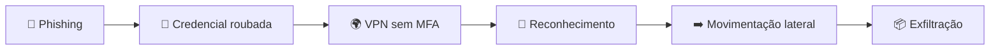

# 🛡️ Anatomia de um Incidente: do Phishing à Exfiltração de Dados

> Análise de SOC (nível júnior) do caso **Tripledobleu Inc.**: como **uma única credencial roubada** levou dados financeiros para fora da rede em cerca de **39 minutos**.

**Autora:** Inara Lopes · **Programa:** Mulher Digital (Junior Achievement Américas) · **Tipo:** Mini projeto técnico

---

## 📑 Índice

1. [Resumo](#1-resumo)
2. [Contexto da empresa](#2-contexto-da-empresa)
3. [Análise das evidências (logs)](#3-análise-das-evidências-logs)
4. [Ameaças, vulnerabilidades e engenharia social](#4-ameaças-vulnerabilidades-e-engenharia-social)
5. [Resposta inicial e contenção](#5-resposta-inicial-e-contenção)
6. [Impacto e lições aprendidas](#6-impacto-e-lições-aprendidas)

---

## 1. Resumo

Uma funcionária caiu em um **phishing**. Dias depois, o atacante usou a senha roubada para entrar na **VPN sem MFA**, explorou a rede, chegou ao **servidor financeiro** e **enviou 11,2 GB** de dados para a nuvem.

| ⏱️ Duração do ataque | 🔐 MFA | 🗜️ Compactado | 📤 Enviado para fora |
|:---:|:---:|:---:|:---:|
| ~39 min | Desativado | 14,7 GB | 11,2 GB |

**Em uma frase:** credencial roubada + ausência de MFA + permissões excessivas + falta de segmentação = acesso aos dados mais sensíveis da empresa.

---

## 2. Contexto da empresa

- 🏢 **Tripledobleu Inc.**: serviços financeiros e plataformas digitais, com operações no México, Colômbia e Estados Unidos.
- 🏠 **Modelo híbrido**: centenas de funcionários acessam servidores e aplicações pela VPN todos os dias.
- ⚠️ **Fraquezas já conhecidas**: senhas fracas, MFA não obrigatório, servidores legados e alertas acumulados sem revisão.

---

## 3. Análise das evidências (logs)

### 3.1 📧 Phishing: o ponto de partida

**A atividade é suspeita porque:**
- o remetente é **externo** e finge ser o suporte de TI (`secure-access-update.com`);
- o link leva a um domínio **parecido com o do Microsoft 365** (`microsoft365-secure-auth.com`);
- pede para "validar credenciais" com urgência.

**Relacionado a:** phishing, coleta de credenciais e **engenharia social**. O e-mail gateway detectou a ameaça, mas a usuária inseriu as credenciais e não reportou.

---

### 3.2 🚨 Tentativas de login malsucedidas

**A atividade é suspeita porque:**
- ocorreu na **madrugada**, fora do horário habitual;
- o IP `185.193.44.18` vem da **Polônia**;
- há **3 falhas consecutivas** para a mesma conta.

**Relacionado a:** roubo de credenciais, força bruta ou acesso não autorizado. É um **indicador inicial de comprometimento de conta**.

---

### 3.3 🔓 Acesso VPN bem-sucedido

**A atividade é suspeita porque:**
- o login veio do **mesmo IP** das falhas anteriores;
- usou **somente senha** (`Password Only`) com **MFA desativado**;
- o dispositivo era um **host Windows desconhecido**.

> 💡 **Este é o momento do comprometimento.** Com MFA, a senha roubada não seria suficiente: foi a principal falha de controle do caso.

---

### 3.4 🌐 Consultas DNS internas

**A atividade é suspeita porque:**
- em menos de 1 minuto foram consultados `HR-SRV-02`, `FIN-SRV-04`, `FILE-SRV-03` e `BACKUP-SRV-01`;
- a Valentina normalmente acessava só plataformas financeiras, em horário administrativo.

**Relacionado a:** **reconhecimento**. O atacante usou o DNS para mapear onde estavam os recursos de valor, incluindo o servidor de backup.

---

### 3.5 📡 Varreduras: alerta do IDS

**A atividade é suspeita porque:**
- o IDS gerou alerta de **severidade alta**;
- a origem é a **sessão VPN da Valentina** (`VPN-SESSION-VALENTINA`);
- a rede `10.10.15.0/24` sofreu **port scanning, enumeração SMB e service discovery**.

**Relacionado a:** reconhecimento interno (camadas 3, 4 e 7 do modelo OSI). O **IDS só alerta**; um **IPS** poderia ter bloqueado a sessão. Uma sessão VPN alcançar um /24 inteiro indica **segmentação insuficiente**.

---

### 3.6 🔑 Permissões excessivas: movimentação lateral

**A atividade é suspeita porque:**
- a conta autenticou com **sucesso** em `FILE-SRV-03` e abriu sessão remota em `FIN-SRV-04` (falhou em `HR-SRV-02`);
- houve **enumeração de compartilhamentos SMB**.

**Relacionado a:** quebra do **princípio do menor privilégio**. Uma analista financeira não precisava de acesso a esses servidores, e os grupos administrativos dos sistemas legados estavam mal segmentados.

---

### 3.7 📦 Compactação e exfiltração de dados

**A atividade é suspeita porque:**
- `archive.exe` compactou **14,7 GB** no `FIN-SRV-04`;
- logo depois, **11,2 GB** saíram por HTTPS para `cloud-sync-storage.net`;
- o volume é muito acima do normal do servidor.

> 💡 O **SIEM correlacionou** os eventos e gerou o alerta **CRITICAL**, mas **tarde**: os dados já estavam saindo.

---

## 4. Ameaças, vulnerabilidades e engenharia social

### 🎯 Ameaças identificadas

`Phishing` · `Comprometimento de conta` · `Acesso não autorizado` · `Reconhecimento interno` · `Movimentação lateral` · `Exfiltração de dados`

### 🕳️ Vulnerabilidades que facilitaram o incidente

| Vulnerabilidade | Consequência |
|---|---|
| **MFA não obrigatório** | Senha roubada foi suficiente para entrar na VPN |
| **Senhas fracas** | Mais fácil roubar, adivinhar e reutilizar |
| **Permissões excessivas** | Conta comum alcançou servidores críticos |
| **Falta de segmentação** | Sessão VPN varreu a rede e chegou a vários servidores |
| **Servidores legados** | Configurações antigas e menos controles |
| **Sem bloqueio por país ou dispositivo** | Login da Polônia e de host desconhecido foi aceito |
| **Sem controle de saída (DLP/egress)** | 11,2 GB saíram por HTTPS sem bloqueio |
| **Alertas acumulados** | Sobrecarga do SOC e risco de ignorar sinais reais |

### 🎭 Fator humano

O e-mail usou **falsa autoridade** (TI), **urgência** ("atualização obrigatória") e **aparência legítima** (domínio parecido com o Microsoft 365). A usuária presumiu que era rotina e **não reportou**, o que impediu uma resposta antecipada.

---

## 5. Resposta inicial e contenção

### 🔴 Imediatas (primeiros minutos)

1. **Confirmar o incidente** e escalar ao responsável de segurança.
2. **Encerrar a sessão VPN** e **bloquear a conta** da Valentina.
3. **Bloquear o IP** `185.193.44.18` no firewall e na VPN.
4. **Bloquear `cloud-sync-storage.net`** para interromper a exfiltração.
5. **Isolar `FIN-SRV-04` e `FILE-SRV-03`**, preservando o estado para investigação.
6. **Preservar evidências** (logs, capturas e horários).

### 🟠 Curto prazo (primeiras horas)

7. **Redefinir a senha** e revogar sessões ativas.
8. **Bloquear os domínios de phishing** (`secure-access-update.com` e `microsoft365-secure-auth.com`).
9. **Identificar outros destinatários** do e-mail e verificar quem inseriu credenciais.
10. **Buscar o IP** em logs de outras contas e **revisar `HR-SRV-02` e `BACKUP-SRV-01`**.
11. **Determinar quais dados foram enviados**.

### 🟡 Médio prazo

12. **Exigir MFA** para todas as contas, começando por VPN e áreas financeiras.
13. **Aplicar menor privilégio** e **segmentar a rede**.
14. **Ajustar IDS/IPS e alertas** para falhas de login, geolocalização e tráfego de saída.
15. **Treinar a equipe** contra phishing e facilitar o reporte de e-mails suspeitos.

---

## 6. Impacto e lições aprendidas

### 💥 Impacto operacional

- **Operações paradas:** sistemas financeiros desconectados, equipes sem acesso a relatórios e pagamentos automatizados falhando.
- **Dados em risco:** possível exposição de informações de clientes corporativos, operações financeiras e documentos internos.
- **Risco para o negócio:** custo de investigação e recuperação, possíveis implicações legais e perda de confiança dos clientes.

### 🧱 Controles de segurança

| ✅ Existiam | ❌ Faltaram ou eram fracos |
|---|---|
| SIEM, IDS, e-mail gateway, VPN e logs centralizados | MFA obrigatório, bloqueio por país/dispositivo, IPS ativo |
| Monitoramento do SOC | Menor privilégio, segmentação de rede, DLP e controle de saída |

### 🔔 Sinais que poderiam ter alertado o SOC

Phishing em quarentena **dias antes** → 3 falhas de login de outro país → login VPN sem MFA em host desconhecido → consultas DNS fora do perfil → **alerta de alta severidade do IDS**.

> 💡 **Lição principal:** os sinais apareceram **cerca de 30 minutos antes** do alerta crítico. Tratar as primeiras falhas de login como incidente, e não como possível falso positivo, teria dado tempo de conter o ataque antes da perda de dados.

---

Projeto acadêmico desenvolvido para o programa Mulher Digital (Junior Achievement Américas). O caso e a empresa são fictícios.
